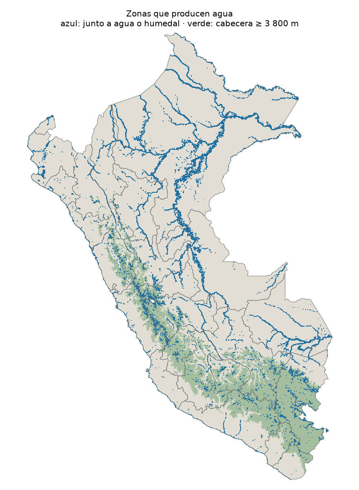
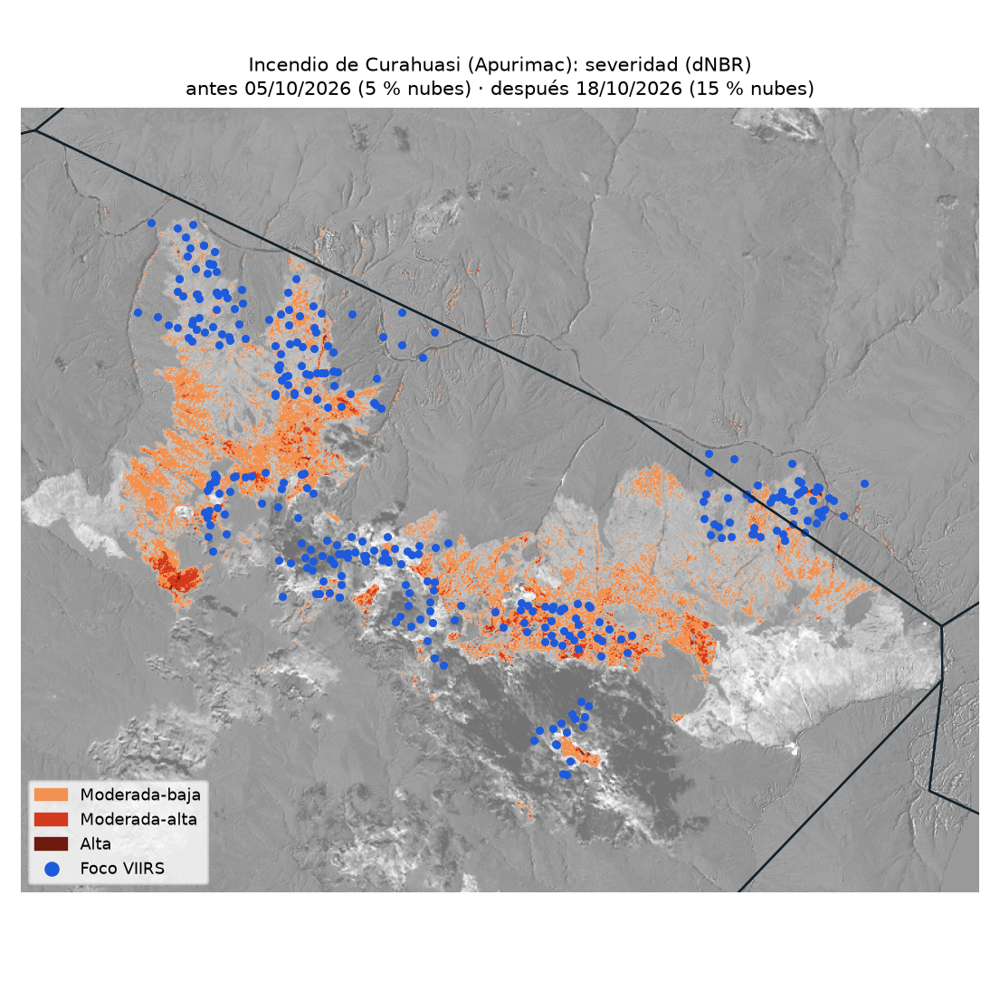

# El fuego y el agua: ¿cuánto del fuego de 2026 cae sobre las zonas que producen agua del Perú?

**Dashboard:** abran [`docs/index.html`](docs/index.html) o la página de GitHub Pages del repositorio.



## La pregunta

¿Qué parte de los focos de calor de la temporada 2026 cae sobre las zonas que producen agua
(cabeceras de cuenca, lagunas, ríos y humedales), cómo se compara con 2012–2025
y en qué departamentos se concentra?

## Hallazgos

1. **24 % de los focos de la temporada cayó en zonas que producen agua.** De 135,171 focos detectados entre el 1 de julio de 2026 y el 22/10/2026, 32,701 cayeron junto a agua o humedales (18,941) o en cabeceras sobre 3,800 m (13,760). Con el satélite S-NPP, la proporción es 24.0 %, el puesto 2 de 15 años desde 2012, y los focos en esas zonas están -6 % frente al promedio 2012–2025 para la misma fecha.
2. **Puno concentra más focos en zonas de agua: 4,011** (85.8 % de sus 4,674 focos de la temporada). Entre los departamentos con más focos en esas zonas, **Lima** es el que más se aleja de su historia: +114 % frente a su promedio 2012–2025.
3. **El incendio de Curahuasi (Abancay, Apurimac) quemó 1,115.5 ha** según el dNBR de Sentinel-2 (moderada-baja 1,001.2 ha, moderada-alta 110.5 ha, alta 3.9 ha). De ellas, 2.1 ha eran agua o humedal. Se compararon las imágenes del 05/10/2026 (4.8 % de nubes en la zona) y del 18/10/2026 (14.8 % de nubes), con el incendio todavía activo.

## Datos y fechas

Corte de datos: **22/10/2026 02:39** (hora de Lima). Todo es gratuito y sin clave.

| Dato | Fuente | Fechas |
|---|---|---|
| Focos 2012–2025 | NASA FIRMS, archivo anual `viirs-snpp` Perú | 1 jul – 22/10 de cada año |
| Focos 2026 | INPE Queimadas (archivo mensual) y NASA FIRMS (últimos 7 días) | 1 jul – 22/10/2026; INPE hasta 21/10 14:19 |
| Cobertura del suelo | ESA WorldCover, vía Planetary Computer | 2021 |
| Relieve | Copernicus DEM 30 m, vía Planetary Computer | — |
| Sentinel-2 L2A, imagen antes | Planetary Computer, `sentinel-2-l2a` | 05/10/2026 (4.8 % de nubes en la zona) |
| Sentinel-2 L2A, imagen después | Planetary Computer, `sentinel-2-l2a` | 18/10/2026 (14.8 % de nubes en la zona) |
| Límites | GitHub `juaneladio/peru-geojson` (INEI) | — |

## Método

1. **Focos:** solo vegetación (se excluyen volcanes y fuentes fijas) y sin confianza baja. Para
   comparar años se usa un solo satélite, S-NPP.
2. **Zonas que producen agua:** celdas de ~1 km junto a cuerpos de agua o humedales (WorldCover,
   clases 80, 90) o con altitud media de 3,800 m o más (Copernicus DEM),
   sobre una grilla común de 0,01°.
3. **Raster → tabla:** cada foco toma la categoría de su celda; luego se agrega por año y por departamento.
4. **Un incendio de cerca:** imagen Sentinel-2 antes y después con poca nube en la zona (banda SCL),
   NBR y dNBR, umbral 0,27 y clases de severidad de Key y Benson (USGS), solo a menos de 1,5 km de los focos.



| Distrito | Moderada-baja | Moderada-alta | Alta | Total |
|---|---:|---:|---:|---:|
| Curahuasi | 984.2 | 108.2 | 2.8 | **1,095.2** |
| Limatambo | 16.9 | 2.2 | 1.1 | **20.2** |

## Limitaciones

- **Un foco de calor no es un incendio:** también detecta quemas agrícolas y de pastos.
- **Las nubes y el humo esconden el fuego**, y los satélites pasan pocas veces al día.
- La capa de agua a ~275 m pierde ríos angostos y bofedales chicos; «cabecera alta» es una
  simplificación (no toda zona alta abastece a una ciudad).
- La comparación histórica usa S-NPP, cuyo sensor envejece.
- El área quemada depende de las dos imágenes elegidas; si el incendio seguía activo, puede ser mayor.

## Cómo reproducirlo

```bash
pip install -r requirements.txt
jupyter Tarea_incendios_clase_.ipynb   # ejecutar todas las celdas
```
